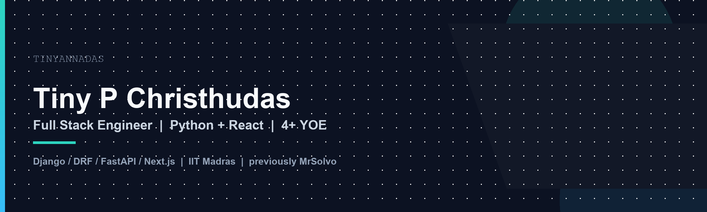

  

 

**Full Stack Engineer (Python + React) · 4+ YOE**

Django/DRF · FastAPI · Next.js. Exploring AI backends (LangGraph, RAG) in personal projects.

 

[Email](mailto:tinypchristhudas@gmail.com)
&nbsp;·&nbsp;
[LinkedIn](https://linkedin.com/in/tinyannadas)
&nbsp;·&nbsp;
[GitHub](https://github.com/tinyannadas)
&nbsp;·&nbsp;
[X](https://twitter.com/tinyannadas)

---

## About

Senior Developer at **IIT Madras** on Study on Campus, and previously Software Engineer at **Mukul Consultants** building [mrsolvo.com](https://mrsolvo.com).

I ship full-stack products end to end: API design, data modeling, frontend, and production hardening. Day job work is Django and React. Personal projects explore FastAPI, LangGraph, and RAG.

---

## Experience

<table>
<tr>
<td width="50%" valign="top">

### IIT Madras
**Senior Developer** · Apr 2026 - Present

Study on Campus academic platform (Django, PostgreSQL): registration, courses, grades.

- Owns student registration and drop workflows
- Fixed a BaseModel status bug causing silent query conflicts
- PR reviews and summer intern interviews

</td>
<td width="50%" valign="top">

### Mukul Consultants
**Software Engineer** · Aug 2023 - Feb 2026

Built [mrsolvo.com](https://mrsolvo.com), a verified-expert marketplace, end to end.

- Cut a critical endpoint from ~2000 queries to ~15
- PageSpeed from the 30s-40s into the 80s; Tailwind migration
- PhonePe / Airpay payments; email and WhatsApp APIs

</td>
</tr>
</table>

---

## Personal projects

<table>
<tr>
<td width="50%" valign="top">

### AI Research Assistant
**Python · FastAPI · LangGraph · FAISS · Docker**

Multi-agent orchestration over REST, RAG document search with FAISS, and one API layer over OpenAI, Anthropic, and Azure OpenAI.

</td>
<td width="50%" valign="top">

### Inhealin
**DRF · React · PostgreSQL · Channels · AWS**

Online therapy platform with multi-role users, JWT auth, booking, and real-time notifications. Amplify frontend, EC2 + S3 backend.

</td>
</tr>
</table>

---

## Tech stack

  

  AI in personal projects: LangGraph · FAISS · OpenAI / Anthropic / Azure OpenAI

---

## GitHub stats

  
  

---

**Open to conversations about full-stack Python + React roles**

[tinypchristhudas@gmail.com](mailto:tinypchristhudas@gmail.com)

